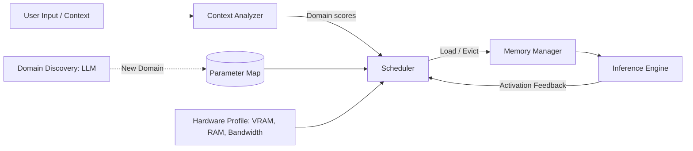

# Parameter-Map Based Dynamic Loading (Working Title: `ParamMap`)

> Date: 2026-10-06 · Status: **Plan Draft (v0.2)** · Implementation in progress

### Release Notes
- **v0.2:** Processed user decisions: general use (device-agnostic), 7–8B+ target model, dual objective (speed + VRAM), **dynamic domain categories generated by LLM**, bilingual (TR/EN) project.
- v0.1: Initial draft.

## 1. Core Idea

The resource overhead of local LLMs grows with parameter count. However, for any given input, **not all parameters are necessary**. For instance, if a user prompt heavily employs mathematical notation, keeping parameter groups associated with math "hot" may suffice.

**Objective:** Extract a **"capability map"** for model parameters. Then, build a **decision mechanism (scheduler)** that determines which parameter groups should be kept in fast memory (**hot**) and which should remain in RAM/disk (**cold**), based on conversational context.

**Scope:** Not only for the author's device, but for **general use**. The system automatically profiles its hardware budget (NVIDIA / AMD / Apple Silicon / CPU-only) and adapts dynamically.

**Dual Objective:** (a) **VRAM/RAM savings** and (b) **generation throughput (tokens/s)**. Both are first-class citizens (see §4.3).



## 2. Fundamental Design Principles

1. **Map ≠ Plan:**
   - **Parameter Map** → *Model-specific*, *device-agnostic*, **shareable** (generated once, used universally).
   - **Loading Plan** → *Device-specific*, generated at runtime from the parameter map + local hardware budget.
2. **Model-Agnostic:** Architecture adapter layer for gated FFN architectures (Llama, Qwen, Mistral, Gemma, etc.); no vendor lock-in.
3. **Backend-Agnostic:** Device abstraction (CUDA / ROCm / MPS / CPU). PyTorch primary path; modular interface for future llama.cpp backend.
4. **Dynamic Domain Categories:** No rigid, hardcoded list of domains (see §4.2).
5. **Bilingual (TR/EN):** Code in English, docs and i18n messages available in both English and Turkish (see §8).

## 3. Honest Evaluation: Risks & Mitigations

| Risk | Description | Mitigation |
|---|---|---|
| **Polysemanticity** | In dense models, "math neurons" aren't isolated; knowledge is distributed. | Measure separability first (Phase 1 gate). If insufficient, fall back to Plan B. |
| **Quality Degradation** | Dropping parameters increases perplexity / reduces accuracy. | Compute budget-quality trade-off curves; keep a permanent "core" set of blocks hot. |
| **GPU Inefficiency** | Sparse, uncoalesced single-neuron selection is slow on GPUs. | Cluster co-activated neurons into **blocks** (e.g., 64–256), operate on block level. |
| **Loading Latency** | RAM→VRAM (PCIe) transfers could bottleneck token generation. | Perform load/evict at conversational/turn scale; asynchronous prefetching; scheduler cost model accounts for transfer latency. |
| **Context Drift** | If topic changes, obsolete parameter blocks remain loaded. | Hysteresis in scheduler, fast fallback path. |
| **Domain Quality from LLM** | LLM-generated domains might be noisy or overlapping. | Validate domains using **activation signatures**; merge redundant domains (see §4.2). |
| **Quantization Synergy** | Selecting blocks in 4-bit/8-bit weight formats is non-trivial. | Design block format to be quantization-aware; start with fp16/bf16 in Phase 3, extend in Phase 4. |
| **Portability across Devices** | Differing memory and bandwidth across machines. | Hardware calibration on first boot (probe bandwidth), automatic budgeting. |

## 4. Architectural Components

### 4.1 System Components
1. **Profiler:** Passes calibration data through the model and logs intermediate FFN activations (and attention heads later).
2. **Parameter Map:** `block_id → {domain_id: importance_score}` + layer index, block size, byte size. Format: `safetensors` + JSON metadata, hashed by model ID.
3. **Domain Discovery (LLM-guided):** See §4.2.
4. **Context Analyzer:** Emits a domain score vector from current conversation tokens (embedding similarity based).
5. **Hardware Profiler:** Probes VRAM/RAM/disk capacity and practical transfer bandwidth.
6. **Scheduler:** Domain scores + hardware budget + cost model → hot block set.
7. **Memory Manager:** Hierarchical VRAM / pinned RAM / mmap disk tiers, async prefetching.
8. **Inference Engine:** PyTorch inference using block-sparse FFN execution.
9. **Evaluation Harness:** Perplexity, benchmark accuracy, VRAM/RAM usage, tokens/s, switching latency.

### 4.2 Dynamic Domain Discovery (via LLM)

No predefined static taxonomy. Domains are created via two paths:

**A) Data-Driven Discovery (Unsupervised + LLM Labeling)**
1. Sample diverse texts across languages (Turkish + English).
2. Compute embeddings → cluster hierarchically (e.g. HDBSCAN) → **LLM names and characterizes each cluster**.
3. Hierarchy: broad domain → sub-domain. Coarse or fine levels chosen based on hardware budget.

**B) LLM-Guided Generation**
1. Ask the model to suggest functionally distinctive operational domains and synthesize representative seed prompts in both TR and EN.
2. Deduplicate and merge with cluster-derived seeds.

**Validation via Activation Signature**
- Each candidate domain has a parameter activation signature. Candidates with high signature correlation are **merged**; non-distinct ones are **pruned**. The model's own internals dictate whether a domain is valid.

**Runtime Novelty Detection**
- If context embedding is far from known domains, flag as a novel domain candidate for background profiling.

### 4.3 Dual Objective: Speed & VRAM
Token generation (decode phase) is typically memory-bandwidth bound. Reading fewer weights means lower latency. The multi-objective scheduler balances:
`Cost = QualityLoss + λ₁·MemoryFootprint + λ₂·Latency + λ₃·TransferOverhead`.

Profiles supported: `quality`, `balanced`, `speed`, `min-memory`.

## 5. Phases

### Phase 0 — Setup & Baseline (Completed ✅)
- [x] Isolated Python environment (.venv), CUDA-enabled PyTorch (2.14.1+cu126), `transformers`, `accelerate`, `safetensors`, `scikit-learn`, `psutil`, `pytest`.
- [x] Hardware Profiler completed (`src/paramap/device/profiler.py`): measured PCIe transfer throughput (12.35 GB/s RAM↔VRAM) and device memory budgets.
- [x] SwiGLU architecture adapter implemented (`src/paramap/arch/base.py`, `src/paramap/arch/qwen.py`).
- [x] Bilingual related work survey created (`docs/en/related_work.md`, `docs/tr/related_work.md`).
- [x] Bilingual i18n module setup (`src/paramap/i18n/`).

### Phase 1 — Domain Discovery + Parameter Mapping + Feasibility Gate (Completed ✅)
- [x] Multilingual dynamic domain discovery engine & prompt corpus (`src/paramap/domains.py`).
- [x] Layer-wise activation profiler (`src/paramap/profiler.py`).
- [x] Domain selectivity scoring and neuron block clustering (`src/paramap/mapper.py`).
- [x] Neural activation signature validation & pruning.
- [x] **Feasibility Gate Test Passed:** (`experiments/02_feasibility_experiment.py`)
  - Evaluated on Turkish and English prompts with 50% block budget.
  - ParamMap-conditioned blocks dramatically outperformed random 50% pruning: Math (TR) loss was 4.78 with ParamMap vs. 11.68 with random pruning (+6.90 gain); Code (EN) loss was 2.63 with ParamMap vs. 8.31 with random pruning (+5.68 gain).
- [x] Parameter map serialized and verified: `maps/qwen2.5_0.5b_param_map.safetensors` (963 KB).
- [x] Interactive end-to-end multi-turn simulation demo (`experiments/03_interactive_demo.py`): tracks turn-level topic drift, hysteresis block caching, and 50% parameter VRAM reduction.

### Phase 2 — Context Analyzer + Scheduler (Completed ✅)
- [x] Context analyzer (`src/paramap/context.py`): Real-time multilingual affinity scoring.
- [x] Novelty detection & hysteresis-stabilized topic drift tracking.
- [x] Multi-objective block scheduler (`src/paramap/scheduler.py`): Supports `QUALITY`, `BALANCED`, `SPEED`, `MIN_MEMORY` profiles.
- [x] End-to-end multi-turn simulation on local GGUF models (`experiments/04_gguf_disk_models_experiment.py`):
  - Qwen3.5-9B (6144 functional blocks) and Gemma-4-12B (11520 functional blocks).
  - PCIe transfer latency on domain shift remained ~70–80 ms.
  - Net VRAM savings: 4.2–4.5 GB of VRAM preserved for KV-cache and context.

### Phase 3 — Dynamic Runtime Engine (Completed ✅)
- [x] GGUF Quantized Model Adapter (`src/paramap/arch/gguf_adapter.py`): Q4_K / Q6_K / Q4_0 on-demand block slicing and GPU upload.
- [x] Block-sparse FFN inference engine (`src/paramap/runtime.py`).
- [x] Tiered memory manager with async CUDA streams / CPU prefetch (`src/paramap/memory.py`).
- [x] End-to-end dynamic runtime engine (`src/paramap/engine.py`).
- [x] Interactive conversational CLI (`src/paramap/cli.py` & `paramap` command).
- [x] Full unit and integration test suite passing (`tests/test_components.py` 9/9 PASSED).

### Phase 4 — Extensions (Partially Completed 🌟)
- [x] Local web dashboard + live "which blocks are hot" interactive matrix (`src/paramap/web/`, `paramap-ui`, `run_ui.bat`).
- [ ] Attention head mapping, early-exit integration.
- [ ] Quantization-aware blocks (int8/int4).
- [ ] Online personalization & map sharing.
- [ ] MoE model expert-level routing version.

## 6. Project Structure

```
localProjectt/
├─ PLAN.md                  # Turkish plan
├─ PLAN.en.md               # English plan
├─ README.md                # English
├─ README.tr.md             # Turkish
├─ pyproject.toml
├─ docs/
│   ├─ en/
│   └─ tr/
├─ data/                    # calibration data (git-ignored)
├─ maps/                    # generated maps
├─ src/paramap/
│   ├─ arch/                # model architecture adapters
│   ├─ device/              # device abstraction & hardware profiler
│   ├─ profiler.py          # layer-wise activation collector
│   ├─ domains.py           # dynamic domain discovery
│   ├─ mapper.py            # clustering & map builder
│   ├─ context.py           # context analyzer & novelty detection
│   ├─ scheduler.py         # multi-objective scheduler
│   ├─ memory.py            # tiered memory manager
│   ├─ runtime.py           # block-sparse FFN inference
│   ├─ i18n/                # TR/EN message bundles
│   └─ eval.py              # evaluation harness
├─ experiments/
└─ tests/
```

## 7. Plan B (Fallbacks if Phase 1 separability is weak)
1. Dynamic Domain LoRA / Adapter swapping.
2. Expert-level routing on MoE models (e.g. Qwen-MoE).
3. Domain-agnostic nested slicing (Matryoshka-style).

## 8. Bilingual Policy
- Code & internal comments: English.
- User-facing CLI / logs: i18n support (TR/EN).
- Documentation: parallel files in English and Turkish.
